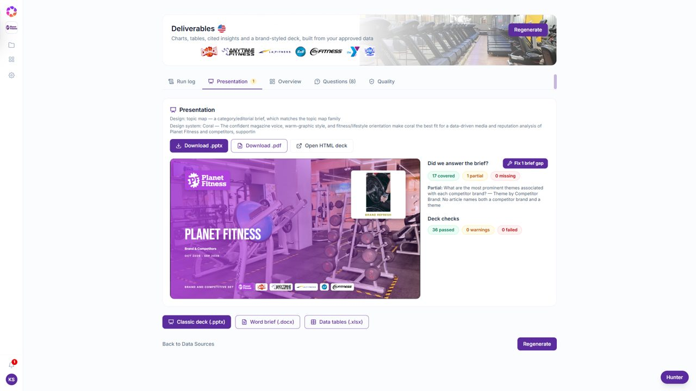
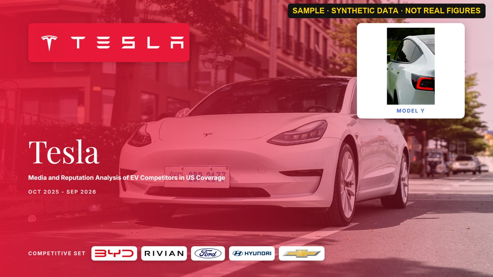
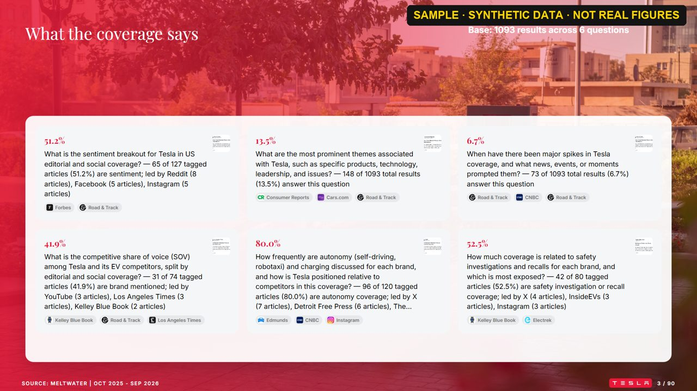
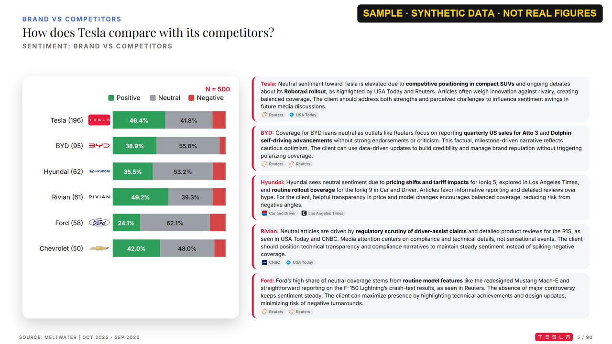
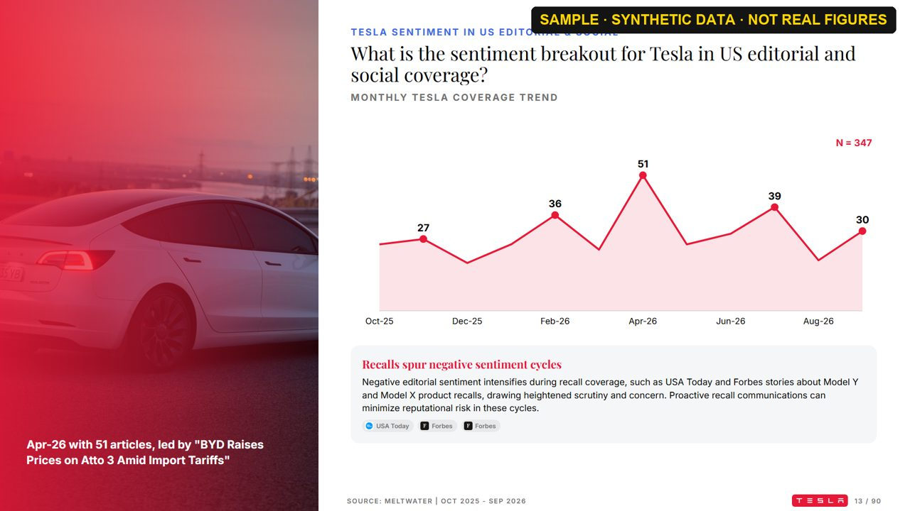
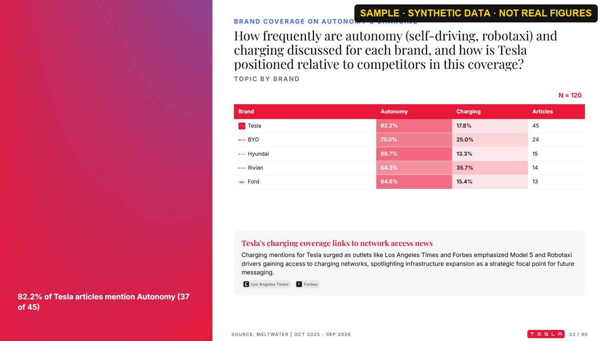
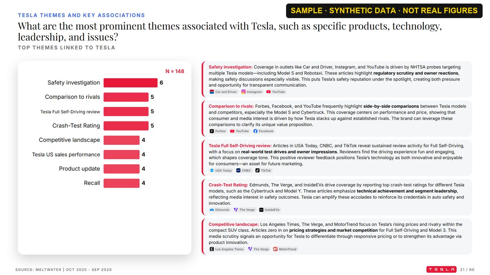

# Hunter Intelligence Platform

Hunter turns a client brief and Meltwater media exports into a cited, brand-styled research deck. You paste
or upload a brief, and it scopes the brief, researches the client and competitors, and writes a Meltwater
search query for each research question. After you upload and approve the matching data, it analyses the
coverage and builds the presentation: charts, insight cards, verbatims and citations, with a check of
whether every part of the brief was answered.

Outputs per run: a **PowerPoint deck** (`.pptx`, plus `.pdf` and an HTML version), a **Word brief**
(`.docx`) and the **data tables** behind every chart (`.xlsx`).

**Live:** frontend on Vercel · API on Render: `https://hunter-intelligence-platform.onrender.com`

---

## Guide video (60 seconds)

[](frontend/public/videos/hunter-how-to-60s.mp4)

Click the image to open the video ([`hunter-how-to-60s.mp4`](frontend/public/videos/hunter-how-to-60s.mp4)).
In the app, the **Help** button in the sidebar plays the same video.

---

## How it works: the stages

Each project moves through five stages, shown in the sidebar. A stage opens once the one before it is
approved.

| # | Stage | What you do | What Hunter does |
|---|---|---|---|
| 1 | **Brief & Scope** | Paste or upload the brief (PDF, Word, PowerPoint, text); review and approve the scope. | Extracts the client, brand, competitors, country/region, period, research questions, expected analyses and deliverables. |
| 2 | **Background Research** | Read and approve. | Researches the brand, competitors and recent news from the web and news search, and writes a background brief. The brand's logo comes from Brandfetch. |
| 3 | **Search Strategy** | Review and edit the queries; approve. | Writes a Meltwater Boolean query for each research question, with a syntax check. |
| 4 | **Data Sources** | Run each query in Meltwater, upload the exports for each question, and approve them. | Reads each export, tags every article against its question (sentiment, themes, brands, entities) and shows which questions have data. |
| 5 | **Deliverables** | Click **Generate**, review, download. Use **Fix** for anything still open. | Builds the deck (see below), then checks it against the brief and its own quality checks. |

### What happens when you click Generate

A live run log shows each stage and how long it takes.

| Step | What it does |
|---|---|
| Ingest | Reads the approved exports. Articles from outside the project's country/region are left out (Global keeps all). |
| Routing | Gives each question the articles uploaded for it, plus any other article that matches its Boolean query. The deck's total is the questions' result volumes added up; the unique-article count is reported beside it. |
| Plan | Chooses the analyses for each question: share of coverage, trend, sentiment, themes, brands, outlets, reach, people, breakdowns and crosstabs. Regenerating with unchanged data reuses the same plan. |
| Classify · Compute | Extracts brands, products and experts, then computes every chart and table. |
| Insights | Writes an insight card for each chart category from the articles behind it, with citations. Every number is checked against the computed facts. |
| Design · Assets | Takes the client's brand colours from its own logo, picks the slide layouts, and finds a logo for each brand. Photos are checked for relevance by a vision model; cover and closing photos must show the client's own brand. |
| Compose · Export | Renders the HTML deck and exports `.pptx`, `.pdf`, the Word brief and the Excel data tables. |
| Validate · Repair | Runs about 35 deck checks and the "Did we answer the brief?" checklist, then repairs what it can automatically. |

Charts follow the [FT Visual Vocabulary](https://ft-interactive.github.io/visual-vocabulary/):

| What the numbers are | Chart |
|---|---|
| Change over time | Line, or columns for a short series |
| Exclusive parts of one whole | Doughnut (2–4 parts), sorted bars (5–7), treemap (8+) |
| Overlapping categories (themes, outlets, brands named) | Sorted horizontal bars |
| One split shown for each brand | 100% stacked bars |
| Two dimensions crossed | Heatmap table |

The run log records the reason for each chart's choice. Client-facing text is written in the language of the
project's country/region (Global: US English).

A separate **QC flow** (Upload Report → QC Results → Export) cleans and checks Meltwater/Empower Excel
exports outside a project.

---

## Sample presentation

> **Every number below is synthetic.** These slides come from a demonstration project built on
> **synthetic, Meltwater-style data** to show the layout. The figures, rankings and statements about the
> brands shown are not real, and each image is stamped to say so.

| | |
|---|---|
|  |  |
| **Cover:** client logo, the theme of the brief, a verified product photo and the competitive set | **Executive summary:** one answer per research question, with sources |
|  |  |
| **Sentiment, brand vs competitors:** 100% stacked bars, with an insight per brand | **Coverage over time:** peaks annotated and explained |
|  |  |
| **Crosstab as a heatmap:** topic by brand | **Themes:** sorted bars, one insight card per theme |

---

## Prerequisites

### Software

| Requirement | Version | Used for |
|---|---|---|
| Python | 3.12 | Backend (FastAPI) |
| Node.js | 20 or newer | Building the React frontend |
| Docker (Docker Desktop or Rancher Desktop) | any recent | Local PostgreSQL 16 (`pgvector/pgvector:pg16`) |
| Playwright Chromium | installed by `playwright install chromium` | Exporting slides, the PDF, social-post screenshots and charts |
| Windows + Microsoft PowerPoint | optional | Only for the legacy **Brief-to-Deck** agent (COM automation); the platform deck does not need it |

### Accounts and keys (`.env`)

Copy `.env.example` to `.env` and fill it in. **Never commit `.env`.**

| Variable | Required? | What it powers |
|---|---|---|
| `DATABASE_URL` | **Required** | PostgreSQL connection. The server does not start without it, and there is no SQLite fallback. |
| `AZURE_OPENAI_ENDPOINT`, `AZURE_OPENAI_API_KEY`, `AZURE_OPENAI_MODEL`, `AZURE_OPENAI_API_VERSION` | **Required** for AI features | Scoping, research synthesis, tagging, insights, photo checks. Without them, each feature falls back to its rule-based version. |
| `NVIDIA_EMBED_API_KEY`, `NVIDIA_EMBED_MODEL`, `NVIDIA_EMBED_API_URL` | Recommended | Embeddings for semantic slide and deck search |
| `NVIDIA_PARSE_*` | Optional | OCR for scanned brief PDFs |
| `BRANDFETCH_API_KEY`, `BRANDFETCH_CLIENT_ID` | Recommended | Brand logos and colours |
| `SERP_API_KEY` (or `SERP_API_KEYS`) | Optional | Google News and Google Images (logo fallback) |
| `TAVILY_API_KEY` | Optional | Additional news search |
| `PEXEL_API_KEY` | Optional | Licensed photos for slides and page headers |

---

## Quick start (local)

```powershell
git clone https://github.com/KhadarSyed/Hunter.git
cd Hunter

# 1. Database
docker compose -f database/docker-compose.postgres.yml up -d
copy .env.example .env        # then set DATABASE_URL and your API keys

# 2. Backend
python -m pip install -r backend/requirements.txt
python -m playwright install chromium

# 3. Frontend
cd frontend
npm install
npm run build                 # writes the built app into backend/static/
cd ..

# 4. Run
python -m uvicorn backend.main:app --host 0.0.0.0 --port 8002
```

Open `http://localhost:8002`. Database tables and migrations are created automatically on first start.

**Developing the frontend:** run the backend as above, then `npm run dev` in `frontend/` and open
`http://localhost:5173`. Vite forwards `/api` and `/ws` to port 8002.

**One-click launcher (Windows):** `.\deploy\start.ps1` or double-click `Start Hunter Agent.bat`.

> **Tip:** if `python` opens the Microsoft Store, call your real interpreter by its full path
> (`where python3`). If a code change doesn't seem to take effect, delete the `__pycache__` folders
> and restart.

---

## Deployment

| Part | Where | How |
|---|---|---|
| Backend + built app | **Render** (Docker, `deploy/Dockerfile`) | Every merge to `main` deploys automatically. Health check: `/api/health`. Set `DATABASE_URL` (Render Postgres) and the API keys as environment variables. |
| Frontend | **Vercel** | Every merge to `main` deploys automatically. Set `VITE_API_BASE_URL` to the Render URL. |

---

## Project layout

```
frontend/          React 18 + TypeScript + Vite + Tailwind; npm run build writes into backend/static/
backend/
  main.py          FastAPI app: mounts every stage's API under /api/intel, the WebSocket, and serves the app
  core/            config, LLM clients (Azure OpenAI chat, NVIDIA embeddings), events, store facade
  domains/<stage>/ one folder per stage: router.py · schemas.py · repository.py · services
  deck/            legacy Brief-to-Deck agent (PowerPoint COM)
  agents/ tools/   LLM agents and deterministic analysis methods
database/          schema + migrations (db.py), Postgres adapter (pg.py), local Postgres compose file
deploy/            Dockerfile, render.yaml, start.ps1
docs/              product and subsystem docs, handover notes, README images
```

## More documentation

- [`docs/CURRENT_STATUS.md`](docs/CURRENT_STATUS.md): status of each stage, endpoints and tables
- [`docs/handover/HANDOVER.md`](docs/handover/HANDOVER.md): architecture, environment variables, database schema
- [`docs/PRODUCT_SPEC.md`](docs/PRODUCT_SPEC.md) and the subsystem guides in [`docs/`](docs/)

## Contributing

- Branch from `main` and open a pull request. Merging to `main` deploys to production.
- Test code, test scripts and step-by-step plans stay on your machine. `.gitignore` keeps `tests/`,
  `test_*.py`, `*.test.tsx`, `e2e/` and `docs/superpowers/plans/` out of the repository.
- Client briefs, datasets and reference decks are never committed.
